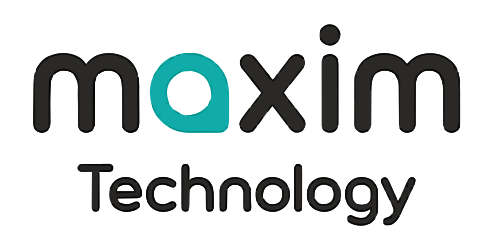

<h1>
  <picture>
    <source media="(prefers-color-scheme: dark)" srcset="frontend/src/resources/logo-light.svg">
    
  </picture>
</h1>

Headlamp is an easy-to-use and extensible Kubernetes web UI.

Headlamp lets you view and manage Kubernetes resources through a graphical interface,
with plugins to extend its functionality.

  

## Features

- Vendor-independent Kubernetes UI
- Runs in-cluster or locally as a desktop app
- Multi-cluster support
- Extensible through [plugins](https://github.com/headlamp-k8s/plugins)
- UI controls that reflect user permissions
- Clean, modern UI
- Cancellable create, update, and delete operations
- Logs, terminal access, and a resource editor with documentation
- Read and write access based on user permissions

## Screenshots

<table>
    <tr>
        <td width="33%"></td>
        <td width="33%"></td>
    </tr>
    <tr>
        <td width="33%"></td>
        <td width="33%"></td>
    </tr>
    <tr>
        <td width="33%"></td>
        <td width="33%"></td>
    </tr>
</table>

## Quick start

To deploy Headlamp in your cluster, follow the
[in-cluster installation guide](https://headlamp.dev/docs/latest/installation/in-cluster/).
Container images are published as `ghcr.io/headlamp-k8s/headlamp` on
[GitHub Container Registry](https://github.com/orgs/headlamp-k8s/packages).

To run Headlamp locally, install the
[desktop application](https://headlamp.dev/docs/latest/installation/desktop/)
for [Linux](https://headlamp.dev/docs/latest/installation/desktop/linux-installation),
[macOS](https://headlamp.dev/docs/latest/installation/desktop/mac-installation),
or [Windows](https://headlamp.dev/docs/latest/installation/desktop/win-installation).
Make sure your kubeconfig is configured for the clusters you want to access.
See the [desktop configuration options](https://headlamp.dev/docs/latest/installation/desktop/#use-a-non-default-kube-config-file)
to use a non-default kubeconfig file or multiple files.

### Access and permissions

Headlamp uses Kubernetes [role-based access control (RBAC)](https://kubernetes.io/docs/reference/access-authn-authz/rbac)
to determine which resources you can view and which actions you can perform.
The resources available in Headlamp depend on the permissions granted to your credentials.

For token-based authentication, see how to
[create a service account token](https://headlamp.dev/docs/latest/installation/#create-a-service-account-token).

## Quick start for contributors

Want to hack on Headlamp? We'd love your help!

See the [contributing guidelines](./CONTRIBUTING.md) for local development setup,
build instructions, and platform-specific tips.

For more detailed documentation, see the [development guide](https://headlamp.dev/docs/latest/development/).

## Tested platforms

See the [Kubernetes platforms](./docs/platforms.md) Headlamp has been tested with.
Please contribute results for other platforms or report regressions.

## Extensions and plugins

Browse [Headlamp plugins on Artifact Hub](https://artifacthub.io/packages/search?kind=21&sort=relevance&page=1)
for published plugins.

See the [plugins repository](https://github.com/headlamp-k8s/plugins) for official plugins.

### Plugin development

To extend Headlamp for your use cases, see the
[plugin development guide](https://headlamp.dev/docs/latest/development/plugins/).

## Get involved

Join the community and contribute:

- [Contribution guidelines](https://headlamp.dev/docs/latest/contributing/)
- [Code of Conduct](./code-of-conduct.md)
- [#headlamp channel on Kubernetes Slack](https://kubernetes.slack.com/messages/headlamp)
- [Monthly community meeting](https://zoom-lfx.platform.linuxfoundation.org/meetings/headlamp)

## Roadmap and release planning

Track upcoming releases in [GitHub milestones](https://github.com/kubernetes-sigs/headlamp/milestones)
and proposed changes in [GitHub issues](https://github.com/kubernetes-sigs/headlamp/issues).
See the [release notes](https://github.com/kubernetes-sigs/headlamp/releases) for changes in published versions.

## License

Headlamp is released under the terms of the [Apache 2.0](./LICENSE) license.

## Frequently asked questions

For more information about Headlamp, see the [Headlamp FAQ](https://headlamp.dev/docs/latest/faq/).
