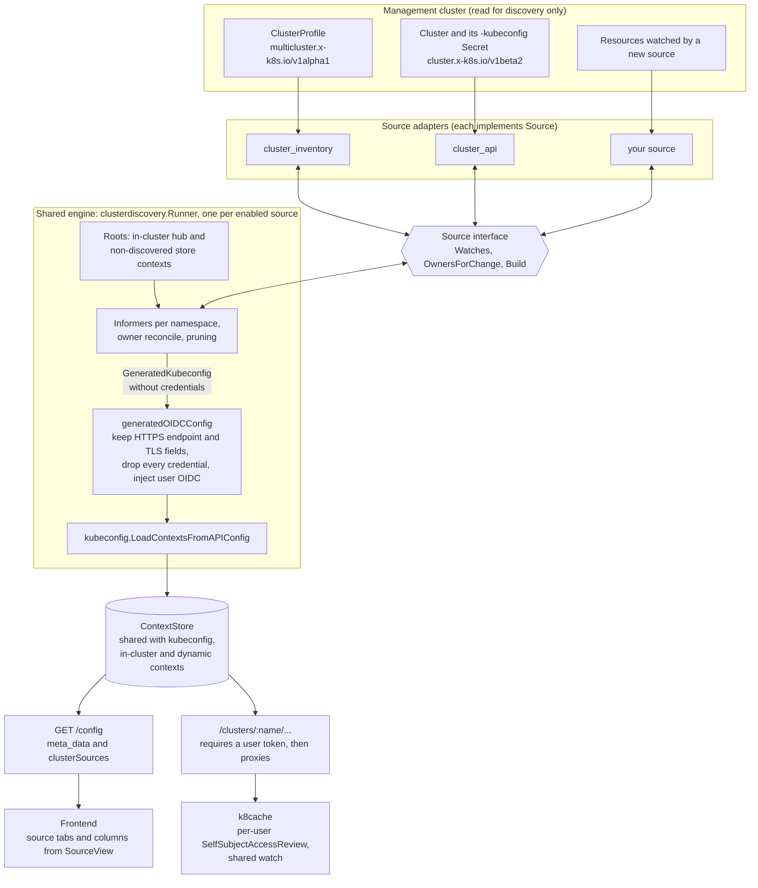
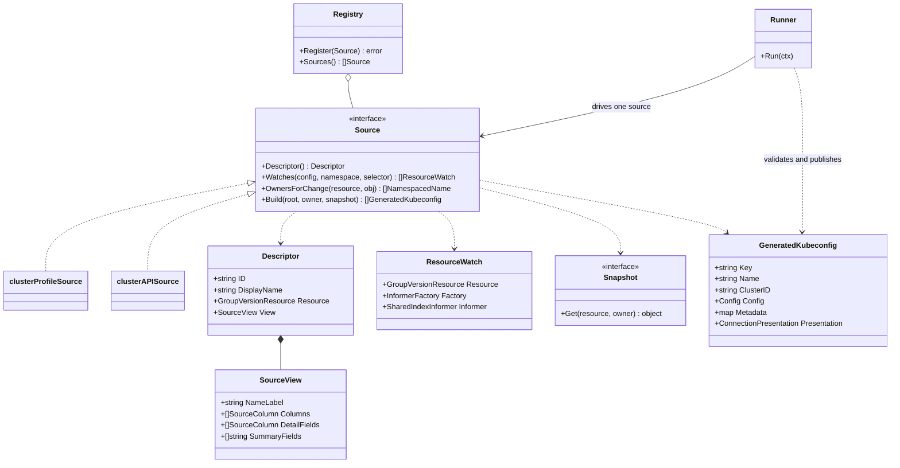
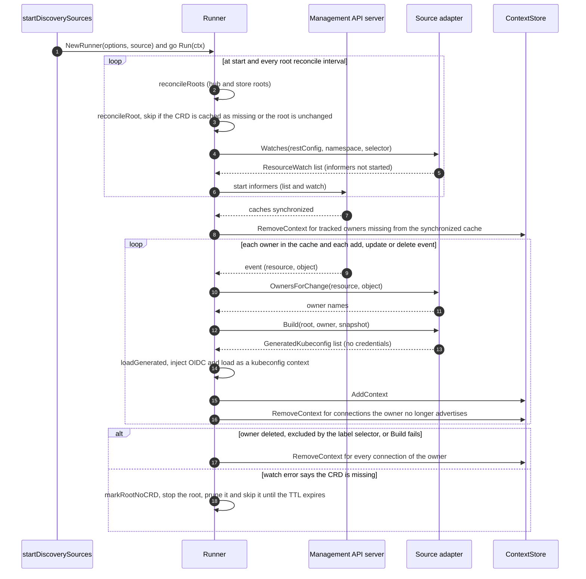
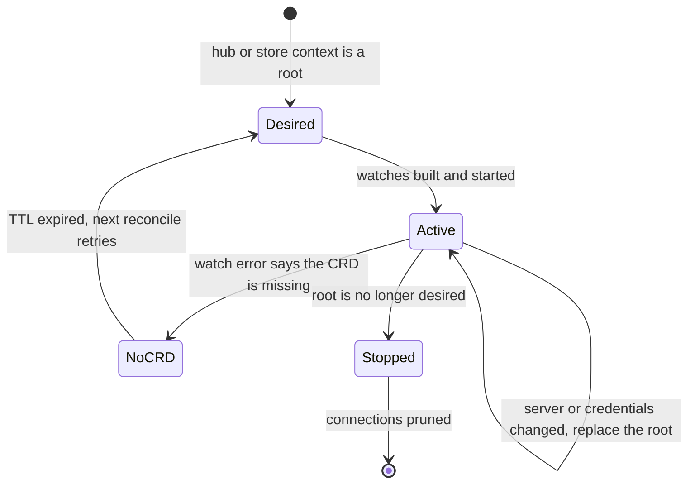
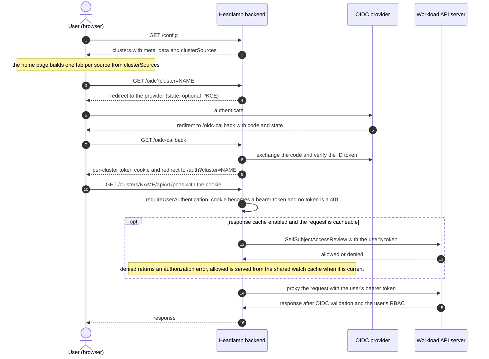

# Cluster discovery sources

Headlamp operators can discover connections from Cluster Inventory API ClusterProfiles
and Cluster API workload Clusters. Both sources produce in-memory kubeconfigs and
use the same OIDC login, kubeconfig loader, proxy, context store, and response cache
as other OIDC connections. Generated connections have no persistent kubeconfig
origin, so their names cannot be edited.

| Source                | Resources read on the management cluster                                  | Workload authentication |
| --------------------- | ------------------------------------------------------------------------- | ----------------------- |
| Cluster Inventory API | `multicluster.x-k8s.io/v1alpha1` ClusterProfiles                          | Each user's OIDC token  |
| Cluster API           | `cluster.x-k8s.io/v1beta2` Clusters and their standard kubeconfig Secrets | Each user's OIDC token  |

A management cluster's credentials are used for discovery only. In-cluster
Headlamp uses its service account and pod namespace. Outside a cluster it uses
non-internal, non-discovered kubeconfig contexts and their namespaces. Connections
created by any discovery source never become discovery roots.

Each source has independent watches and CRD availability tracking. A management
cluster can provide either API or both; one missing API does not disable the
other. Transient watch failures retry without discarding previously discovered
connections. Once caches synchronize, removed owners and invalid connections are
pruned. Names and IDs remain stable when connection settings change. Entries from
different sources remain separate even when their API server URLs match.

## Design

Sources only describe what to watch and how to turn a resource into a connection.
Everything else is shared: informer lifecycle, pruning, OIDC, the kubeconfig
loader, the context store, the proxy, the response cache, and the home page
views. A discovered connection is therefore an ordinary OIDC kubeconfig context
and follows the same path as one loaded from a kubeconfig file.

The extension contract is the `Source` interface. The engine calls it and owns
everything the interface does not mention.

## Flows

### Discovery

Each enabled source gets its own `Runner`. Roots are the in-cluster hub and, outside
a cluster, the non-internal, non-discovered contexts in the store. A root is
reconciled at start-up and then every root reconcile interval.

A root moves through these states. A missing CRD never affects other sources
because each `Runner` keeps its own cache.

### Signing in and using a discovered connection

Discovery never stores workload credentials. Each user signs in through the
configured OIDC provider, and every request reaches the workload API server with
that user's own token. Kubernetes validates the token and applies the user's RBAC.

## Adding a Go source

Implement `clusterdiscovery.Source` and register it in `BuiltinSources`. Registration
also exposes `enable-<source>`, `<source>-namespaces`, `<source>-label-selector`,
`<source>-root-reconcile-interval`, and `<source>-no-crd-cache-ttl` flags, with
underscores in the source ID replaced by hyphens:

- `Descriptor` supplies a stable source ID, display name, primary resource, and
  `View` with the name-column label, text columns, additional connection-detail
  fields, and compact summary fields.
- `Watches` creates unstarted informer factories and caches for a namespace.
- `OwnersForChange` maps primary or dependency events to an owner name.
- `Build` reads the cache snapshot and returns one `GeneratedKubeconfig` per
  connection, including its stable key, name, ID, public metadata, and optional
  `Presentation` display name and string fields.

Each output contains exactly one context and connection information, without
cluster credentials. The engine supplies the configured OIDC user, copies only
supported connection fields, and invokes `LoadContextsFromAPIConfig`. Sources do
not create proxies or write directly to the context store.

The engine owns informer startup, initial synchronization, shutdown, root
replacement, and connection publication and removal. Adapters can use typed or
dynamic client-go informers. Source-specific metadata is JSON; it must not contain
credentials. The source display name is returned as `meta_data.sourceLabel`. Its `View` is
returned in `/config.clusterSources`; enabled sources remain available as tabs
even when they have no connections. The frontend renders those column definitions
without source-specific components.

### What a new source touches

`backend/pkg/clusterdiscovery/extensibility_test.go` defines a source that exists only
in that file and runs it through the unmodified engine. It checks registration,
the home page view, the OIDC connection, credential removal, update and delete,
rejection of invalid output, and coexistence with the built-in sources.

| Layer | Change for a new source |
| --- | --- |
| Source adapter | One new Go file that implements `Source` |
| Registration | One line in `BuiltinSources` |
| Flags, settings and validation | None. They are generated from the descriptor for every registered source |
| Engine: roots, informers, pruning, OIDC, loader, store | None |
| Proxy, user authentication, response cache | None. They only see an OIDC kubeconfig context |
| Home page tabs, columns and details | None. They come from `Descriptor.View` |
| Translations | Optional. Labels missing from `labelTranslations` in `frontend/src/helpers/clusterPresentation.ts` are shown untranslated |
| Helm values and e2e manifests | Optional, only to expose the source there |

New sources put their public data in `GeneratedKubeconfig.Metadata`. Cluster Inventory
additionally keeps a typed `Context.ClusterInventory` field for compatibility.

## Cluster names and source views

The home page has an All tab and a tab for each available source. All shows common
status, warning, version, origin, and action columns. Source tabs add their own
fields. Column visibility, sorting, and filters are saved separately for each tab.

| Source                | Display name                 | Source columns                              |
| --------------------- | ---------------------------- | ------------------------------------------- |
| Kubeconfig            | Custom name or context name  | Cluster, context namespace, kubeconfig file |
| Cluster Inventory API | ClusterProfile resource name | Resource namespace, access provider         |
| Cluster API           | Cluster resource name        | Resource namespace, management context      |

`Cluster.name` remains the connection key for routes, authentication, saved
appearance, and recent selections. `meta_data.presentation.displayName` supplies
the human-readable name; an existing custom name takes precedence. The engine
adds the owner's namespace and management context name to `presentation.fields`; adapters
supply fields such as `provider` or `secret`. These fields contain no credentials.
A workload context's default namespace remains separate from the resource namespace.

Cluster selectors show the same display name and source summary. Identical labels
are distinguished by management context, then by connection ID. The Connection
details action shows the raw connection ID and provides a copy button. A source's
`detailFields` adds fields to this dialog without adding table columns or summary
text. Cluster API shows the kubeconfig Secret reference here. Older
servers without these definitions retain the context names and common columns.

This is a compiled Go extension point. It does not load executables or dynamically
installed Headlamp UI plugins.
