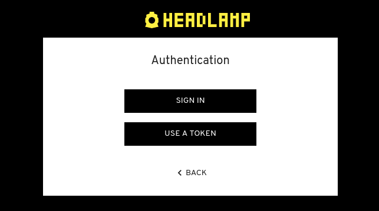

Headlamp supports OIDC for cluster users to effortlessly log in using a "Sign in" button.



To use OIDC, Headlamp needs to know how to configure it, so you have to provide the following OIDC-related arguments to Headlamp from your OIDC provider:

- the client ID: `-oidc-client-id` or env var `HEADLAMP_CONFIG_OIDC_CLIENT_ID`
- the client secret: `-oidc-client-secret` or env var `HEADLAMP_CONFIG_OIDC_CLIENT_SECRET`
- the issuer URL: `-oidc-idp-issuer-url` or env var `HEADLAMP_CONFIG_OIDC_IDP_ISSUER_URL`
- (optionally) the callback URL: `-oidc-callback-url` or env var `HEADLAMP_CONFIG_OIDC_CALLBACK_URL`
- (optionally) the OpenId scopes: `-oidc-scopes` or env var `HEADLAMP_CONFIG_OIDC_SCOPES`

and you have to tell the OIDC provider about the callback URL, which in Headlamp it is your URL + the `/oidc-callback` path, e.g.:
`https://YOUR_URL/oidc-callback`.

### Callback URL

You must tell your OIDC provider the callback URL that Headlamp will use after login. This is your Headlamp URL plus `/oidc-callback`, for example:

```
https://YOUR_URL/oidc-callback
```

> **ℹ️ Note:** If you're running Headlamp behind an ingress or load balancer (e.g., NGINX, AWS ALB/NLB), make sure it forwards the `X-Forwarded-Proto` header. Otherwise, Headlamp may generate the callback URL using `http` instead of `https`, which can cause a mismatch with your OIDC provider.
>
> For [NGINX ingress](https://kubernetes.github.io/ingress-nginx/user-guide/nginx-configuration/annotations/), you can add:
>
> ```yaml
> nginx.ingress.kubernetes.io/configuration-snippet: |
>   proxy_set_header X-Forwarded-Proto $scheme;
> ```

### Provider logout

Provider logout targets Headlamp's server-owned OIDC contexts, including the
single-provider in-cluster configuration. Stateless kubeconfig contexts retain
local-only logout; their user-scoped provider redirect flow and sequencing
multiple independent providers are outside this feature's scope.

When the OIDC provider advertises an `end_session_endpoint`, Headlamp uses it to end the
provider session during logout. This prevents the next sign-in from silently reusing the
previous provider session.

In the desktop app, logout opens an isolated window using the backend's cookie
session. Provider pages have no desktop preload or Node.js access; the main
Headlamp window stays on its trusted application page.

Logout hints are retained for the configured session lifetime, rather than the
shorter access-token lifetime. Logout invalidates the first token-cookie chunk
and clears any other chunks visible to that endpoint. Cookies hidden by their
path expire naturally; readers cannot authenticate without the first chunk, and
new tokens use terminal markers to exclude stale suffixes. This avoids emitting
the maximum possible number of deletion headers on every logout response.
Large provider tokens still require appropriately sized proxy response-header
buffers; chunking is not a guarantee that every token fits a 4 KiB response.

Set `-oidc-callback-url` to the registered Headlamp login callback URL, for example:

```
-oidc-callback-url=https://YOUR_URL/oidc-callback
```

Headlamp uses this configured URL as the trusted origin for the post-logout return. Register
`https://YOUR_URL/encoded-clusters/<base64url-cluster>/login` as an allowed post-logout
redirect URI with the provider for each OIDC cluster. For example, the cluster name `main`
uses `https://YOUR_URL/encoded-clusters/bWFpbg/login`. If Headlamp uses a base path, include
it in both URLs; for example, a base path of `/headlamp` uses
`https://YOUR_URL/headlamp/oidc-callback` and
`https://YOUR_URL/headlamp/encoded-clusters/bWFpbg/login`.

If `-oidc-callback-url` is not configured, Headlamp still ends the provider session but does
not request an automatic redirect back to Headlamp. Providers without an
`end_session_endpoint` retain the existing local-only logout behavior.

To clear the local Headlamp session without ending the provider session, set
`-oidc-skip-logout=true` or the `HEADLAMP_CONFIG_OIDC_SKIP_LOGOUT` environment variable to
`true`.

### Troubleshooting: Real time updates not working, Large JWT Tokens with Ingress NGINX

If you notice real time updates not working, this could be the cause.

If your OIDC provider issues large JWT tokens (e.g., >8KB), you may encounter issues with WebSocket connections or authentication headers being truncated when using Headlamp behind an Ingress NGINX controller.

To resolve this, increase the header buffer size using the following annotation in your [NGINX Ingress](https://kubernetes.github.io/ingress-nginx/user-guide/nginx-configuration/annotations/) resource:

```yaml
nginx.ingress.kubernetes.io/server-snippet: |-
  large_client_header_buffers 4 64k;
```

> **ℹ️ Note:** Regular HTTP requests may still work even with large tokens, but WebSocket connections are more sensitive to header size limits and may fail unless this buffer is increased.

### Scopes

Besides the mandatory _openid_ scope, Headlamp also requests the optional
_profile_ and _email_
[scopes](https://openid.net/specs/openid-connect-basic-1_0.html#Scopes).
Scopes can be overridden by using the `-oidc-scopes` option. Remember to
include the default ones if you need them when using that option.
For example, if you need to keep the default scopes and add GitHub's `repo`,
then add them all to the option:

`-oidc-scopes=profile,email,repo`

**Note:** Before Headlamp 0.3.0, a scope _groups_ was also included, as it's
used by Dex and other services, but since it's not part of the default spec,
it was removed in the mentioned version.


### Auto-login

By default, Headlamp shows a "Sign in" button for OIDC clusters. To bypass this screen and redirect users to your Identity Provider (IDP) you can use the auto-login flag.

- `-oidc-auto-login=true` OR env var `HEADLAMP_CONFIG_OIDC_AUTO_LOGIN`

> **ℹ️ Note:** This will only cause a redirect if the user is not currently authenticated and the selected cluster is configured in OIDC.

### Token Validation Overrides

In the event your OIDC Provider issues `access_tokens` from a different Issuer URL or clientID audience than its `id_tokens` (i.e. Azure Entra ID) you may have need of the following parameters to configure what is used in validation of tokens.

- `-oidc-validator-client-id=<clientID audience to validate in token>` or env var `HEADLAMP_CONFIG_OIDC_VALIDATOR_CLIENT_ID` which is the clientID headlamp should be verifying in the `aud` field of the token provided back from the OIDC provider.
- `-oidc-validator-idp-issuer-url=<issuerURL to use in validation>` or env var `HEADLAMP_CONFIG_OIDC_VALIDATOR_IDP_ISSUER_URL` which is the IssuerURL headlamp should be verifying in the `iss` field of the token provided back from the OIDC Provider

### Use Access Tokens instead of ID Tokens

By default, headlamp leverages the `id_token` provided back from the OIDC Provider after authentication returned to the `/oidc-callback` endpoint. For some Identity Providers like Azure Entra ID, the `access_token` is what is used for authorization to Kubernetes clusters. To instruct headlamp to use the `access_token` instead of the `id_token`, the following flag can be used.

- `-oidc-use-access-token=true` or env var `HEADLAMP_CONFIG_OIDC_USE_ACCESS_TOKEN`

### Multi-cluster: broadcast the OIDC token across sibling clusters

When a single Headlamp instance serves several Kubernetes clusters that all trust the **same** OIDC application (same issuer URL and client ID), an operator can opt in to broadcasting the auth cookie to every matching sibling cluster after a successful login. This eliminates per-cluster re-authentication for the common deployment shape where one OIDC app (Okta, Keycloak, Dex, Entra ID, etc.) is registered with every `kube-apiserver` in the fleet.

- `-oidc-use-token-broadcast=true` or env var `HEADLAMP_CONFIG_OIDC_USE_TOKEN_BROADCAST`

**Precondition.** A sibling cluster receives the broadcast only when its kubeconfig context's OIDC auth-provider has BOTH a non-empty `idp-issuer-url` AND a non-empty `client-id` that match the source cluster's. Contexts using a different auth-provider (e.g. `gcp`, `azure`) or a static token are skipped silently.

**Scope.** Broadcasting fires at initial OIDC login and broadcasts whichever token is in use (the `id_token`, or the `access_token` when `-oidc-use-access-token=true`). The token is stored once, in a shared cookie named after a hash of the issuer URL + client ID (`headlamp-auth~shared-<key>`, path `<baseURL>/clusters/`), so the login response does not grow with the number of clusters. Which clusters may read that cookie is decided on the server from each cluster's own kubeconfig auth-provider, by identity only: a cluster reads the shared token when it is an operator-configured context with an OIDC auth-provider whose `idp-issuer-url` and `client-id` hash to that key. The same rule decides which clusters a login is shared with, and no file (such as the IdP CA) is read for it: the CA matters for that cluster's own login and token refresh, not for reading the shared token. The shared token itself is never inspected (it may be an opaque access token); the key binds it to an issuer + client ID, a different client ID of the same issuer has its own shared cookie, and the `kube-apiserver` verifies it. The shared token is resolved once per request by the OIDC middleware and handed to the request handlers in the `Authorization` header; the shared cookie never reaches a handler, so it can never be forwarded to a `kube-apiserver`. Clusters added at runtime (dynamic clusters) and per-user contexts are deliberately excluded from the shared token, both as the cluster that logs in and as recipients: a client can add such a cluster pointing at an arbitrary API server and claim any issuer in its kubeconfig, so the shared token would otherwise be forwarded there. This differs from the previous broadcast, which did include them. They still authenticate with their own cookie as before. A token set manually for a cluster (set-token) always wins over the shared token, and a broadcast never touches the siblings' own cookies: a sibling that still holds an older per-cluster OIDC cookie keeps using it until it expires or is refreshed, exactly as before. When any cluster on the shared token refreshes it, the refreshed token is written back to the shared cookie and all of them keep working from a single refresh.

**Login and logout semantics.** Logging in to one cluster logs you in to all clusters of the same identity (same issuer + client ID); logging out is per cluster. Logging out of one cluster marks that cluster as logged out (`headlamp-auth-<cluster>.out`, a 30-day marker that outlives any session) and stops it from reading the shared token; the other clusters are unaffected. The shared cookie itself is not removed on logout: it lives until the session TTL (sliding with each refresh), just as the old per-cluster copies did after a logout. A new OIDC login on **any** cluster of the same identity lifts the markers of all its siblings, exactly as the previous broadcast re-set every sibling's cookie on login; setting a token manually for a cluster lifts that cluster's marker. The shared cookie is removed from every request before it is forwarded to a `kube-apiserver`.

**Caveats to be aware of before enabling.**

- The flag is **disabled by default**; with the flag off nothing changes: the shared cookie is never read, no token is promoted, no cookie is stripped and no logout marker is set or lifted.
- Audience mismatches are not detected here. A target apiserver's accepted audiences come from its OIDC client ID (`--oidc-client-id`) or the `audiences` list in a structured [AuthenticationConfiguration](https://kubernetes.io/docs/reference/access-authn-authz/authentication/#using-authentication-configuration); if a target is configured to require a different or additional audience than the source, the shared token may be set but the target apiserver could reject it. Align deployment configuration in that case.
- When `-oidc-use-access-token=true`, the broadcast carries the `access_token` rather than the `id_token`. Unlike the `id_token`, an access token's audience is provider-specific and is frequently **not** the client ID (many IdPs — Okta, Entra ID, Auth0 — set it to a resource/API identifier). Matching issuer + client ID therefore does not by itself guarantee the access token is accepted by a sibling apiserver; ensure the access-token audience is honored fleet-wide before relying on broadcast with this flag.
- The login response carries the shared token cookie once, two small clearing headers for the cluster that logged in (its own cookie and its logout marker) and one per sibling (its logout marker). With very large multi-cluster kubeconfigs this may still approach browser cookie count limits.
- After logging out of a cluster, the shared token stays in the browser (HttpOnly) until the session TTL expires or the user logs out of the identity provider. This is the same exposure the per-cluster copies had.
- Chunked cookies: a token is stored in chunks of 3800 bytes and the chunk following the last one is cleared; reading stops at the first missing chunk, so a re-issued token that needs fewer chunks is read back intact and stale higher chunks of a longer predecessor are ignored until they expire.

### Example: OIDC with Keycloak in Minikube

If you are interested in a comprehensive example of using OIDC and Headlamp,
you can check the
[tutorial on setting up OIDC with Keycloack in Minikube](./keycloak/).

### Example: OIDC with Entra ID in AKS

If you are interested in a comprehensive tutorial of using OIDC and Headlamp in AKS,
you can check the
[tutorial on setting up OIDC with Entra ID in AKS](./azure-entra-id/).

For quick reference if you are already familiar with setting up Entra ID,

- Add the callback URL (e.g. `https://YOUR_URL/oidc-callback`) to your Azure App Registration's `redirectURIs`
- Set `-oidc-client-id` to your Azure App Registration's clientID
- Set `-oidc-client-secret` to your Azure App Registration's clientSecret
- Set `-oidc-idp-issuer-url` to `https://login.microsoftonline.com/<Your Azure Directory (tenant) ID>/v2.0`
- Set `-oidc-scopes` to `6dae42f8-4368-4678-94ff-3960e28e3630/user.read,openid,email,profile`
- Set `--oidc-validator-idp-issuer-url` to `https://sts.windows.net/<Your Directory (tenant) ID>/`
- Set `-oidc-validator-client-id` to `6dae42f8-4368-4678-94ff-3960e28e3630`
- Set `-oidc-use-access-token=true`
- Set `-oidc-auto-login=true` (optional to skip the "Sign in" screen)

### Example: OIDC with Dex

If you are using Dex and want to configure Headlamp to use it for OIDC,
then you have to:

- Add the callback URL (e.g. `https://YOUR_URL/oidc-callback`) to Dex's `staticClient.redirectURIs`
- Set `-oidc-client-id` as Dex's `staticClient.id`
- Set `-oidc-client-secret` as Dex's `staticClient.secret`
- Set `-oidc-idp-issuer-url` as Dex's URL (same as in `--oidc-issuer-url` in the Kubernetes APIServer)
- Set `-oidc-scopes` if needed, e.g. `-oidc-scopes=profile,email,groups`

**Note** If you already have another static client configured for Kubernetes for the [apiserver's OIDC](https://kubernetes.io/docs/reference/access-authn-authz/authentication/#configuring-the-api-server) (OpenID Connect) configuration, use a **single static client ID** i.e `-oidc-client-id` for both Dex and Headlamp. Additionally, the **redirectURIs** need to be specified for each client.

### Troubleshooting: OIDC sign-in succeeds but the cluster rejects your token

If you can sign in via OIDC but are returned to the "Sign in" screen with a message that the cluster rejected your token (and cannot load cluster resources), the cluster's **API server** is most likely not configured to trust the same OIDC provider as Headlamp. Headlamp only forwards the token to the API server, and the API server is what accepts or rejects it, so it must be OIDC-aware with a matching issuer, client ID, and audience.

Make sure the API server is configured for the same OIDC provider (via its `--oidc-issuer-url` / `--oidc-client-id` flags or the equivalent [structured authentication configuration](https://kubernetes.io/docs/reference/access-authn-authz/authentication/#configuring-the-api-server)), so that `--oidc-issuer-url` matches Headlamp's `-oidc-idp-issuer-url` and `--oidc-client-id` matches Headlamp's `-oidc-client-id`.

Managed control planes (e.g. AKS, EKS, GKE) may not accept arbitrary OIDC flags on the API server. If that is the case, use the provider's managed identity/OIDC integration instead. When the API server rejects the token, Headlamp logs a warning containing `API server rejected the forwarded bearer token (401)`.
