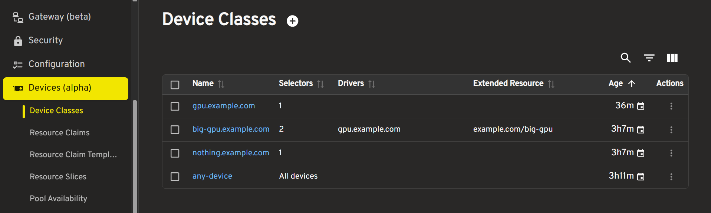
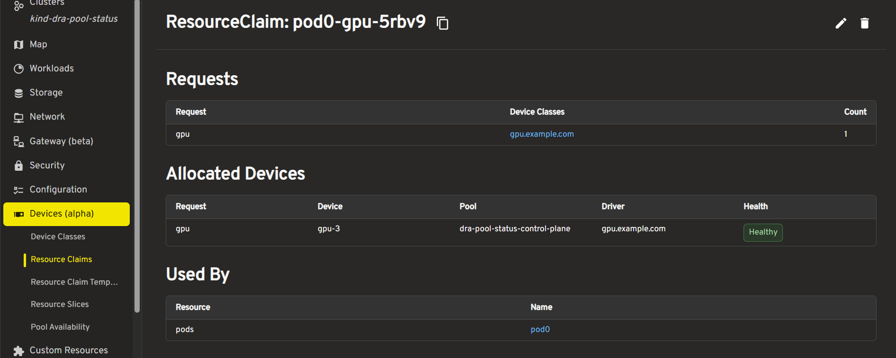
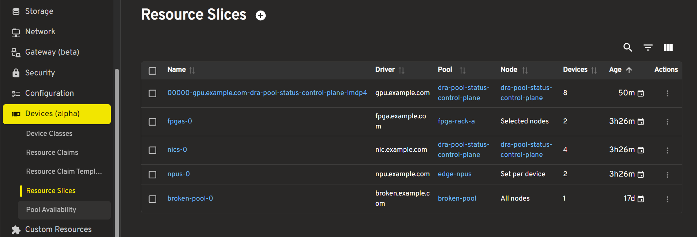
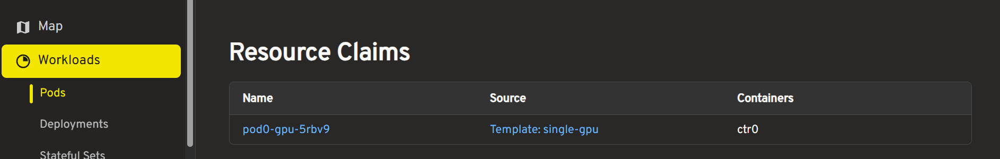
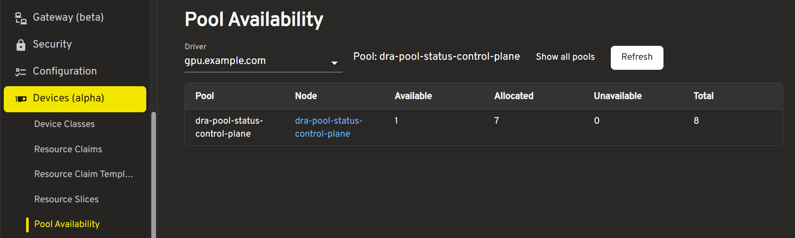
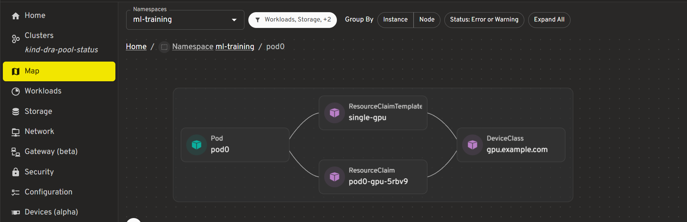

The **Devices (alpha)** section shows the objects of [Dynamic Resource Allocation](https://kubernetes.io/docs/concepts/scheduling-eviction/dynamic-resource-allocation/) (DRA). Use it to see which devices a cluster offers, which device a Pod got, whether that device is healthy, and how many devices are free.

## Requirements

- Kubernetes v1.34 or later, serving the `resource.k8s.io/v1` API.
- A DRA driver installed in the cluster, for example a GPU or network driver.

Headlamp shows the **Devices (alpha)** section only for clusters that serve `resource.k8s.io/v1`. Older beta versions of the API are not supported.

## Device Classes

A DeviceClass is a kind of device that can be requested, such as "a GPU from this driver". A driver usually creates its classes when it is installed.

The **Device Classes** list shows, for each class:

- **Selectors**: how many selectors the class has. A class without selectors shows **All devices**.
- **Drivers**: the drivers the class passes settings to.
- **Extended Resource**: the name a Pod can use to ask for this device in `resources.limits`, if the class has one.

A class's page shows its **Selectors**, its **Driver Configuration** (the settings it passes to each driver), and its extended resource name.

## Resource Claims

A ResourceClaim is a request for devices. After scheduling, it records the devices it got.

The **Resource Claims** list shows each claim's status:

- **Pending**: no device is allocated yet.
- **Allocated**: a device is picked, but no consumer has reserved the claim yet.
- **In use by N**: N consumers, usually Pods, have reserved the claim. A Pod can reserve a claim before it starts.

A claim's page shows:

- **Status** and **Node**: where the claim is, and the node its devices are on.
- **Requests**: each request, its device class, and how many devices it asks for.
- **Allocated Devices**: each device the claim got, with its pool and driver. If the request listed alternatives, **Chosen Alternative** shows which one was used.
- **Health**: **Healthy**, **Unhealthy**, or **Unknown**, as reported by the kubelet. Hover over the label to see the reason.
- **Used By**: the consumers that reserved the claim, usually Pods.

## Resource Claim Templates

A ResourceClaimTemplate creates one claim for each Pod that uses it. A template's page shows its **Requests** and, for each Pod that uses it, the claim it made. If the claim does not exist yet, it shows **Not generated yet**.

## Resource Slices

A ResourceSlice lists the devices a driver offers, grouped into pools. There is no Device object, so a slice is where a device's details live.

The **Resource Slices** list shows each slice's driver, pool, number of devices, and where the devices can be used:

- A node name: all devices are on that node.
- **All nodes**: the devices can be used from any node.
- **Selected nodes**: the devices can be used from nodes that match a node selector.
- **Set per device**: each device says where it can be used.

A slice's **Devices** table shows each device's attributes, such as model, and capacity, such as memory. For a **Set per device** slice, a **Node** column shows where each device is. If a driver marks a device with a taint, a **Taints** column appears. `NoSchedule` and `NoExecute` taints prevent allocation to claims that do not tolerate them. A `NoExecute` taint also evicts Pods whose claims do not tolerate it. A taint with effect `None` is informational.

## A Pod's claims

On a Pod's page, the **Resource Claims** section lists each claim the Pod uses, where it comes from, and which containers use it. A claim can come from:

- a ResourceClaim, by name;
- a ResourceClaimTemplate, shown as **Template:** and the template name;
- an **Extended resource**, when a container asks for a device in `resources.limits`.

A claim made from a template has a generated name that is only in the Pod's status. Click it to open the claim.

## Pool Availability

**Pool Availability** shows how many devices of a driver are **Available**, **Allocated**, and **Unavailable**, out of the **Total**, for each pool. The numbers come from the cluster, through a ResourcePoolStatusRequest.

It needs:

- Kubernetes v1.36 or later with the `DRAResourcePoolStatus` feature gate enabled for the API server and controller manager, and the `resource.k8s.io/v1alpha3` API explicitly enabled on the API server (for example, with `--runtime-config=resource.k8s.io/v1alpha3=true`).
- Permission to list ResourceSlices and to create and get ResourcePoolStatusRequests. Delete permission lets Headlamp clean up requests immediately; by default, only cluster admins can create them.

Headlamp shows **Pool Availability** in the sidebar only for clusters that serve this API.

To open it, select **Pool Availability** and pick a driver, or click a pool name in the **Resource Slices** list to filter the results to that pool. Select **Show all pools** to remove the pool filter, and **Refresh** to count again. Results are limited to 100 pools; opening a specific pool only filters the returned results and cannot retrieve a pool omitted by this limit.

A pool that the cluster could not count shows **Incomplete** or **Not counted** instead of a number. Hover over the label to see the reason. On Kubernetes v1.38 or later, the page says when a driver is still publishing a pool and waits. On earlier versions, the request can stay pending instead. If there is no result after 30 seconds, Headlamp says that the pool may still be publishing or be incomplete.

## Map

Open the **Map** and turn on the **Devices (alpha)** group. The Map then shows each Pod linked to its claims and templates, and those linked to their DeviceClasses. Pods that only share a DeviceClass are not grouped together.

## Troubleshooting

**The Devices (alpha) section is missing.** Check that the cluster runs Kubernetes v1.34 or later and serves `deviceclasses` in `resource.k8s.io/v1`. Also check that Headlamp can reach the cluster and access API discovery; a failed discovery request hides the section.

**A list is empty.** For device classes and resource slices, check that a DRA driver is installed and running. For resource claims and templates, check the selected namespaces.

**Health shows Unknown.** Headlamp has no known health report from the Pods using the claim. Check that a Pod uses the claim, that you can read it, and that the driver reports health to the kubelet. Also check that `ResourceHealthStatus` is enabled on the API server and kubelets; it is disabled by default on Kubernetes v1.34–v1.35.

**Pool Availability is missing from the sidebar.** Check that Headlamp can reach the cluster and access API discovery; a failed discovery request hides the entry. Then check that the cluster serves `resourcepoolstatusrequests` in `resource.k8s.io/v1alpha3`. If it does not, enable the `DRAResourcePoolStatus` feature gate for the API server and controller manager, and enable the API with `--runtime-config=resource.k8s.io/v1alpha3=true`.

**Pool Availability says you are not allowed.** By default, only cluster admins can create ResourcePoolStatusRequests. A role also needs to list ResourceSlices and get the requests it creates.
