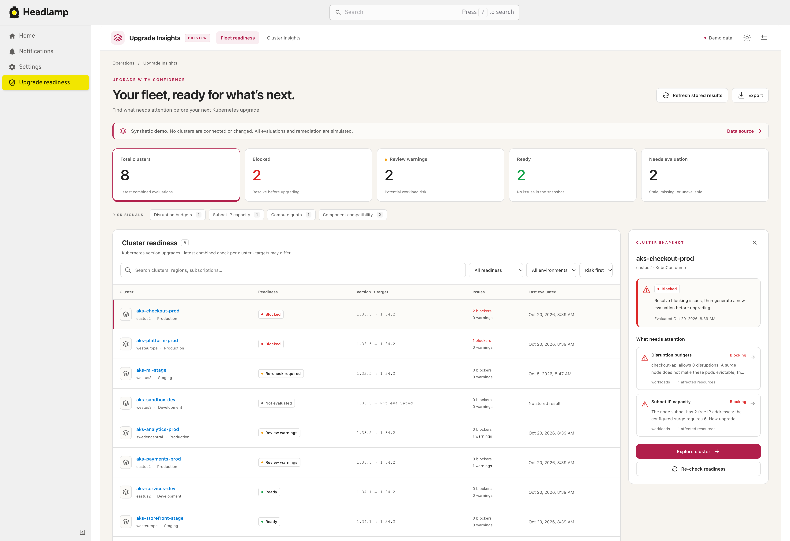
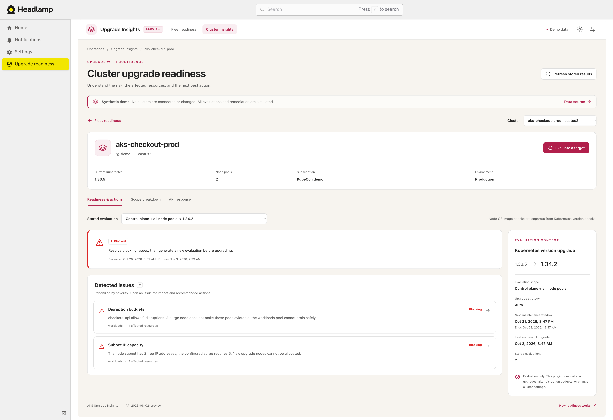

# AKS Upgrade Insights for Headlamp

**A KubeCon-ready prototype for discovering upgrade risk across AKS clusters.**

This initial draft adds a Headlamp plugin with a fleet readiness overview and a
single-cluster workspace. It is grounded in the AKS Upgrade Insights preview API
contract and uses clearly labeled, synthetic scenarios for its out-of-the-box demo.
The standalone preview and Headlamp plugin share the same UI and data adapters.

> **Prototype, not a supported AKS product.** Demo results are fictional. The live
> integration has not been validated against a preview-enabled customer cluster or
> the AKS Desktop build. A readiness result is a point-in-time evaluation, not an
> upgrade guarantee. This plugin never starts a cluster upgrade.

## Screenshots

### Fleet readiness

Prioritize blockers and warnings, filter by issue category, and inspect a cluster
in a side panel without losing the fleet list.



### Cluster readiness

Inspect the evaluated upgrade scope, affected resources, remediation guidance, and
the exact stored API response.



## Start the offline demo

```sh
npm ci
npm run demo
```

Open [http://127.0.0.1:5178](http://127.0.0.1:5178). No Azure login, cluster,
network access, or external data is needed.

Eight demo clusters exercise blocked, warning, ready, expired, and missing
evaluation states. Try the two-minute walkthrough:

1. Select **Blocked** and inspect `aks-checkout-prod`.
2. Open **Disruption budgets** and review the impacted Kubernetes resource and the
   recommended next steps.
3. Simulate remediation. The existing evaluation remains blocked; the cluster is
   not changed.
4. Re-check readiness and inspect the request body. The simulated evaluation is
   now ready for the selected version.
5. Explore the cluster to compare control-plane and agent-pool scopes, see a
   separate node-image evaluation, and review the API response.
6. Reset the demo scenarios from **Data source** settings.

## What is included

- **Fleet readiness:** rollup counts, filters, issue categories, sorting, search,
  export, and an in-context cluster inspector.
- **Cluster workspace:** readiness and freshness, control-plane and agent-pool
  breakdowns, affected resources, safe remediation links, maintenance context,
  selectable stored scopes, and API response inspection.
- **Evaluation dialog:** review the exact `generateUpgradeInsights` request. Demo
  requests are simulated. Live requests require an explicit confirmation.
- **Typed API adapter:** subscription-scoped cluster inventory, per-cluster
  `upgradeInsights` LIST, server-provided pagination, and synchronous generation.
- **Offline fixtures:** separate Kubernetes version and node OS image scenarios,
  with no implicit substitution to mock results in live mode.
- **Loopback Azure CLI bridge:** opt-in, read-only by default, limited to the
  subscriptions and ARM operations explicitly selected by the operator.

## API and readiness behavior

The implementation targets the `2026-08-02-preview` API:

```text
GET  {managedClusterId}/upgradeInsights?api-version=2026-08-02-preview
POST {managedClusterId}/generateUpgradeInsights?api-version=2026-08-02-preview
```

Fleet view aggregates per-cluster LIST results in the client; it does not assume a
fleet API exists. Cluster targets can differ and remain visible per row. Kubernetes
version and node OS image evaluations are separate scopes.

GET/LIST read stored evaluations and do not compute readiness. Generation is
synchronous and stores a fresh result; it **does not start an upgrade**. The plugin
uses the server-provided `expiresAt` and also applies a clearly client-side
24-hour freshness threshold. Missing/incomplete scopes, failed requests, unknown
statuses, expired snapshots, and changed source versions are never called **Ready**.
The 24-hour threshold is a demo client policy, not the server retention period.

The linked Headlamp [PR #5747](https://github.com/kubernetes-sigs/headlamp/pull/5747)
visualizes node upgrade execution from Kubernetes Events. Execution progress is
distinct from pre-upgrade readiness and is not fabricated by this plugin.

## Build the Headlamp plugin

```sh
npm ci
npm run typecheck
npm test
npm run build
npm run package
```

The official Headlamp SDK creates `dist/main.js` and
`aks-upgrade-insights-0.1.0.tar.gz`. The archive is intentionally not committed;
the source, lockfile, tests, and screenshots are.

The archive layout is `aks-upgrade-insights/main.js` plus `package.json`. Install
the archive using the plugin directory appropriate to your installed Headlamp or
AKS Desktop version. Restart the host and verify its plugin management screen;
development watch mode can target a different application profile than packaged
AKS Desktop. See [`SETUP.txt`](SETUP.txt) for macOS paths and operational detail.

The global Headlamp page is `/aks-upgrade-fleet`; the selected-cluster page is
`/c/<context>/aks-upgrade-insights`. In demo mode a real kubeconfig context is not
silently matched to a synthetic cluster. Select a demo cluster explicitly.

## Optional live-data bridge

Live access is **not required** for the demo. See [`SETUP.txt`](SETUP.txt) before
enabling it. In brief:

- The local bridge listens only on loopback and uses the operator's existing
  `az rest` authentication.
- It defaults to read-only, allowlists explicit subscriptions and read endpoints,
  validates browser origin and a short-lived in-memory pairing key, and does not
  expose Azure bearer tokens to the UI.
- Readiness generation can be enabled deliberately with `--allow-generate`; the
  UI then requires approval of the exact POST request. It still cannot execute
  upgrades or other cluster-resource writes.
- The bridge and live API have not been validated with a preview-enabled AKS
  cluster. Feature registration, service rollout, permissions, browser policy,
  and AKS Desktop support must be confirmed by the environment owner.

## Limitations

- No fleet-native API, upgrade execution, automatic remediation, node-event
  progress display, polling, or background re-evaluation.
- No Azure sign-in UI, identity/token storage, or automatic mapping of kubeconfig
  contexts to ARM resources.
- Live inventory is scoped to explicitly configured subscriptions. Partial
  inventory failures are surfaced; counts cover reachable subscriptions only.
- Demo state is in-memory and resets when the page reloads.
- English-only interface; production-scale virtualization is not implemented.

## Project structure

```text
src/api/types.ts          Validated API/domain schemas
src/api/arm.ts            Per-cluster ARM API provider
src/api/demo.ts           Clearly labeled synthetic provider
src/domain.ts             Freshness, scopes, conservative readiness
src/App.tsx               Shared fleet and single-cluster experience
src/index.tsx             Headlamp route and sidebar registration
bridge/server.mjs         Optional loopback-only Azure CLI bridge
demo/                     Standalone local preview
docs/images/              Screenshots shown above
```

## Validation

The initial draft was checked with TypeScript, domain/adapter/UI tests, bridge
allowlist tests, production preview and plugin builds, and the official SDK
packager. The packaged UMD plugin was loaded in an isolated local Headlamp 0.35.0
instance with an empty kubeconfig; no user plugin profile was changed. AKS Desktop
installation and live AKS API access are not yet validated.
