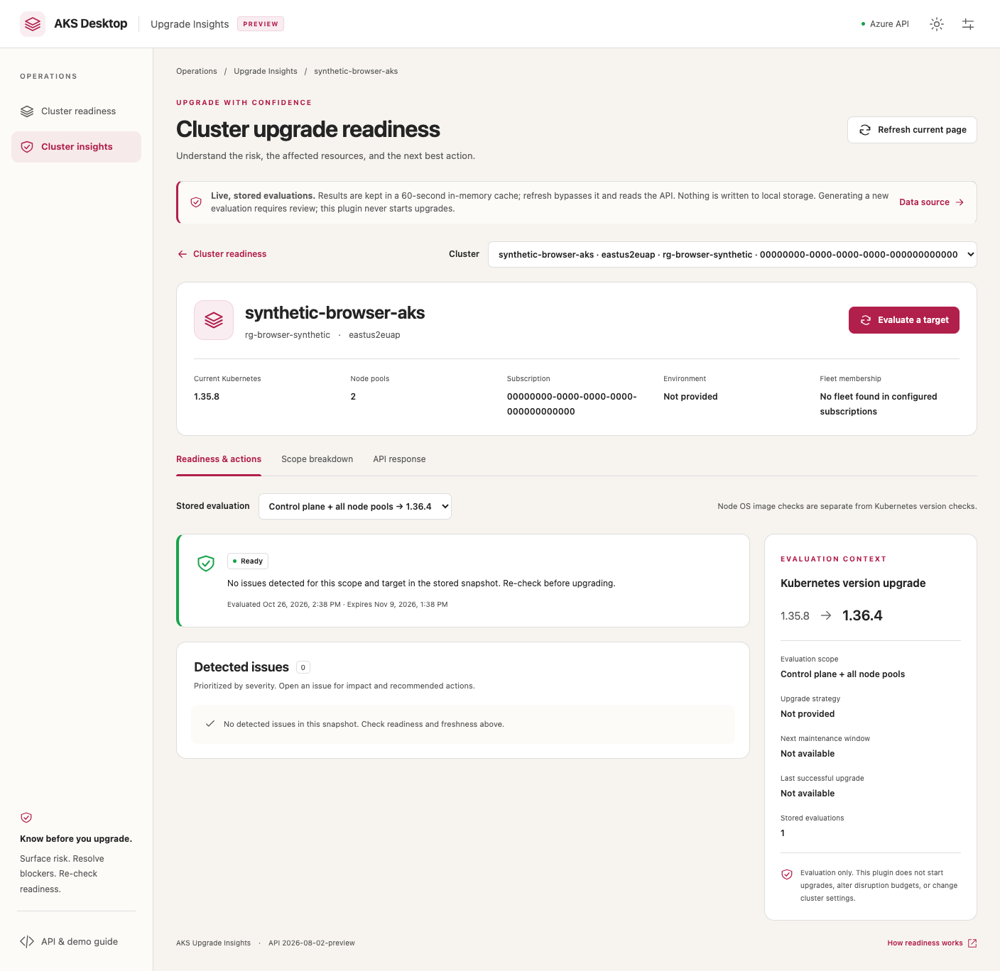
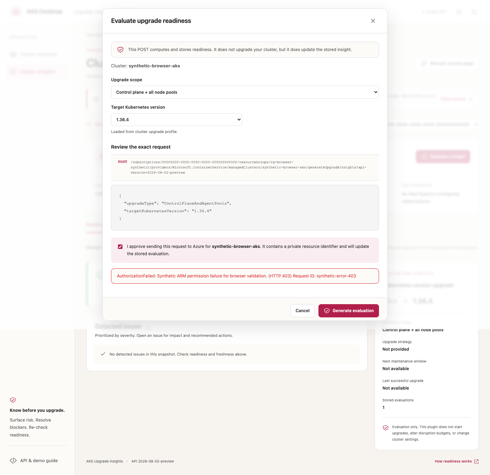

# ARM integration test results

Validated on October 26, 2026.

This note separates automated regression tests, browser tests with synthetic
responses, and requests to a real Azure Resource Manager service. It deliberately
omits cloud resource identifiers, request IDs, credentials, private logs, and
deployment telemetry.

## Automated checks

Run from `plugins/aks-upgrade-insights` after installing the committed lockfile:

```sh
npm run typecheck
npm test
npm run build
npm run demo:build
npm run package
```

| Check | Result |
| --- | --- |
| TypeScript typecheck | Passed |
| Vitest | 73 passed |
| Native Node bridge/transport tests | 26 passed |
| Total automated tests | **99 passed** |
| Headlamp plugin build | Passed |
| Standalone demo build | Passed |
| Plugin packaging | Passed |
| Whitespace validation | Passed |

Regression coverage includes:

- Raw ARM `properties` envelopes rather than flattened SDK responses.
- Nullable cluster `agentPoolProfiles` and missing/null upgrade lists.
- Dedicated agent-pool upgrade profiles and scope-isolated target caches.
- Exact server-returned insight GETs and cache invalidation after stale GETs.
- Standard ARM error envelopes and bare service `{code, message}` errors.
- Preserved HTTP status, request ID and retry metadata.
- Explicit subscription authentication and token confinement to the bridge.
- Operator-only preview opt-in and strict route/subscription allowlists.
- NodeImage evaluation independent of Kubernetes target-profile access.
- Explicit, provider-session-only Headlamp context-to-ARM resource bindings.
- Default read-only behavior, request cancellation and response-size limits.

## Real-cluster adapter and bridge validation

The actual `ArmProvider` and `bridgeTransport` were executed against the actual
local bridge, using Azure CLI authentication and real HTTPS ARM responses.
Only the browser Origin header and local evidence recording were supplied by
the test harness; response bodies were not mocked or replaced.

The owner approved an isolated, temporary, single-node Linux cluster and
readiness-generation requests. No actual upgrade was permitted.

**16 real ARM requests: 8 checks passed, 1 not applicable.**

| Check | Result |
| --- | --- |
| Cluster inventory and explicit target selection | Passed |
| Cluster and dedicated pool upgrade-profile reads | Passed |
| Initial stored-insight LIST | Passed |
| ControlPlane Generate and exact persisted GET | Passed; readiness `Passed` |
| Combined Generate and exact persisted GET | Passed; control plane and pool readiness `Passed` |
| AgentPool-only Generate | Not applicable: the pool profile exposed no Kubernetes upgrade targets |
| NodeImage Generate and exact persisted GET | Passed; concrete image target resolved; readiness `Passed` |
| LIST refresh, generated-record inclusion and cache reuse | Passed |
| Missing named insight | Passed expected negative case: actual HTTP 404 and `NotFound` diagnostics preserved |

All nine insight requests were correlated to actual serving instances. This
establishes which deployment handled the requests, not that any particular
latest release or untested server-side change was validated.

The run exposed two wire-compatibility issues that were fixed and retested:

1. A cluster profile can return `agentPoolProfiles: null`. Control-plane parsing
   now tolerates it; pool target discovery uses the dedicated pool endpoint.
2. Service errors can arrive as bare `{code, message}` objects. They now retain
   their diagnostics just like wrapped ARM errors.

Cluster versions, node image, node count, and provisioning state were unchanged
before and after readiness testing. The temporary resource group and managed
node resource group were verified deleted. The bridge was stopped.

Raw cloud evidence and identifiers remain outside the repository.

## Browser checks with synthetic responses

These screenshots are **synthetic browser tests**, not real-cluster screenshots.
All displayed resource identifiers and the permission failure are fictional.

The browser checks verified:

- Control-plane targets from a raw ARM response.
- Separate targets for a selected pool.
- User confirmation before a Generate request.
- Generate followed by the exact server-returned insight GET.
- Rendering a verified combined result.
- Rendering an intentional HTTP 403 with its error code and request ID.

### Verified-result presentation



### Expected-error presentation

The 403 below was injected intentionally to test diagnostics; it is not an
unresolved Azure authentication failure.



## Coverage limits

- The real-cluster run tested the data adapter and bridge, not a live browser
  session or native AKS Desktop authentication/CSP integration.
- No Windows, Machines-mode, cross-tenant live workflow, or sovereign-cloud
  runtime validation was performed.
- AgentPool-only generation was not counted as passed when no target was
  available.
- No real upgrade, reimage, drain, eviction, remediation, feature registration,
  or shared routing change was executed.
- Full host frontend/backend and desktop E2E suites were not run for this
  plugin-only change. The package-specific checks above were run.
